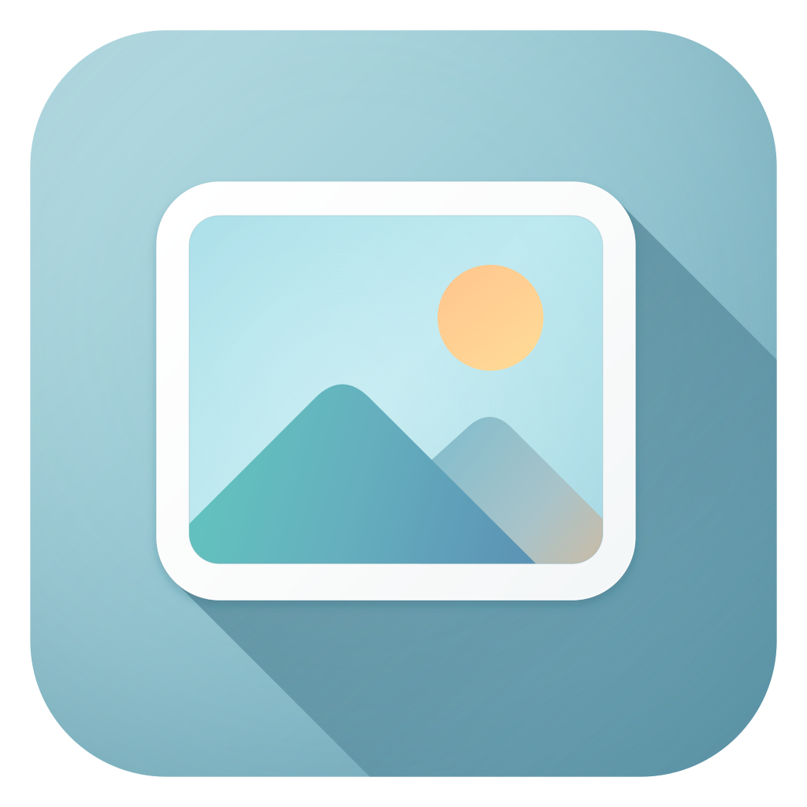
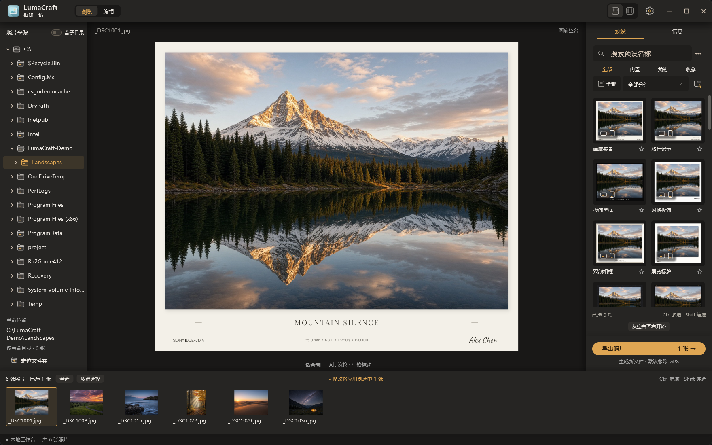
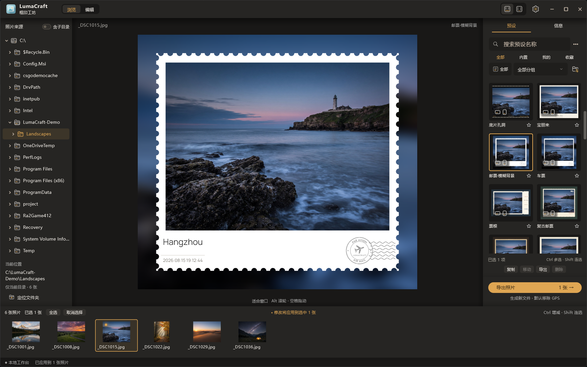
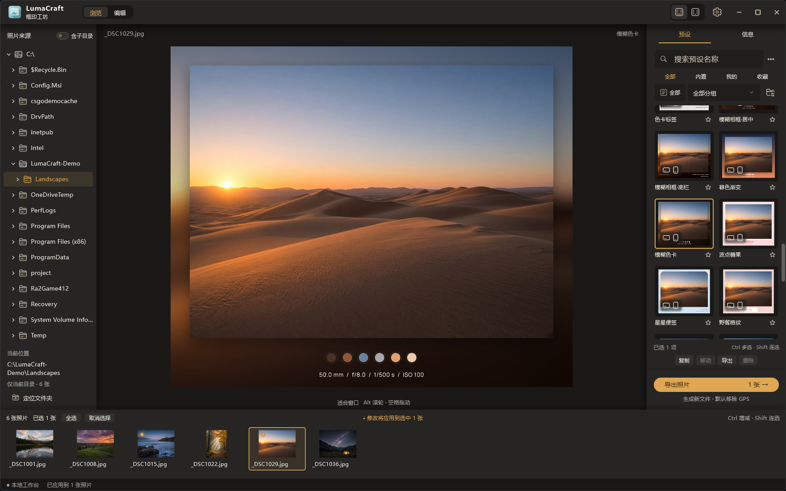
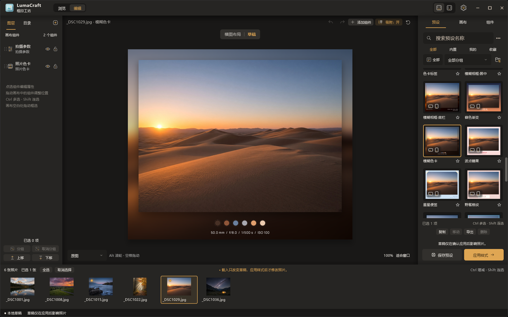

<div align="center">



# 框印工坊 · LumaCraft

**给照片加边框与信息水印的本地桌面工具**

不联网、不上传，所有处理都在本机完成


[下载](#下载) · [功能](#功能) · [从源码运行](#从源码运行) · [路线](#路线) · [许可证](#许可证)

<br />



</div>

---

## 截图

<div align="center">

| 邮票边框 | 色卡边框 |
|:---:|:---:|
|  |  |



<sub>截图中的风景照片为 AI 生成的模拟照片，相机信息为演示数据。</sub>

</div>

## 为什么是它

- **本地** — 照片只在本机处理，不上传；导出时默认移除 GPS 定位信息
- **不动原图** — 只生成新文件，原始照片不会被改动
- **能自己做** — 内置 41 款边框预设，也能在编辑器里从零设计，并用文件、二维码、文本代码分享
- **批量** — 一次选多张照片，套用同一个预设批量导出；导出被中断后可以接着做
- **好上手** — 单击、Ctrl 多选、Shift 连选、框选，快捷键参考 Adobe 系软件

> 当前为 **Beta** 版本，功能可用但仍在完善，遇到问题欢迎反馈。

## 功能

**浏览与导入**
- 目录树直接浏览磁盘，可包含子目录，大目录也流畅
- 支持 JPG / JPEG，以及 HEIF / HEIC（使用 Windows 自带解码，需系统安装对应扩展）
- 照片被移动或改名后，可按文件名与拍摄时间自动接回

**编辑器**
- 组件：自由文字、相机 / 镜头 / 时间 / 地点 / 拍摄参数、色卡、图片标识、多种形状
- 图层、分组、对齐、吸附、撤销重做
- 四边边框、背景（纯色 / 渐变 / 照片模糊 / 纹理）、投影、胶片与邮票打孔、照片描边
- 横图、竖图可分别覆盖布局；内置 8 款字体
- 地点可通过高德地图搜索选点，或读取照片 GPS 自动填写（需自备高德 Key，可选）

**预设与分享**
- 预设库：搜索、分组、收藏、多选管理
- 分享为 `.lmp` 文件、二维码或文本代码；也可以从分享图片里读取二维码导入

**导出**
- 单张或批量导出，可选择输出目录与命名方式
- 导出中途软件被关闭，下次启动可从中断处继续（中断时正在处理的那一张不会重做）

## 下载

在 [Releases](https://github.com/EnderBull/LumaCraft/releases) 页面下载：

| 文件 | 说明 |
|---|---|
| 安装包 | 双击安装，适合日常使用 |
| 绿色版压缩包 | 解压即用，不写注册表，适合随身携带 |

系统要求：Windows 10 / 11（64 位）。

## 从源码运行

需要 [Flutter](https://docs.flutter.dev/get-started/install/windows)（稳定版，Dart 3.4 及以上）以及 Windows 桌面开发环境。构建前需要在 Windows 设置里打开「开发者模式」（插件需要创建符号链接）；只有构建的电脑需要，使用软件的电脑不需要。

```powershell
cd app
flutter pub get
flutter run -d windows
```

构建发行版：

```powershell
cd app
flutter build windows --release
```

> 构建时如果加上 `--dart-define=LUMACRAFT_AUTHORING=true`，会打开内置预设维护等开发用入口；默认不加，即为普通用户使用的版本。

运行测试（必须加 `-j 1` 让测试逐个运行：部分测试会真实读写同一个数据目录并等待定时器，同时运行会互相干扰而误报失败）：

```powershell
cd app
flutter test -j 1
```

## 路线

- 已完成：Windows 桌面版，JPG / HEIC 输入，边框编辑器，预设分享，批量导出
- 计划中：Android，之后考虑 macOS / iOS
- 暂不支持：RAW 输入

## 许可证

- **代码**：以 [GPL-3.0](LICENSE) 许可证开源。你可以自由使用、修改和分发；分发修改后的版本时，需要同样以 GPL-3.0 开源。
- **Logo 与品牌素材**（`app/assets/branding/` 下的图标与图片）：保留所有权利，不在 GPL-3.0 授权范围内。未经许可，请勿用于你自己的软件或产品标识。
- **字体**：内置字体各自使用 SIL Open Font License 1.1，许可证文本随软件分发，见 `app/assets/fonts/`。
- **第三方依赖**：均为 BSD / MIT / Apache-2.0 等宽松许可证，与 GPL-3.0 兼容。
- 手机、相机品牌相关的内置边框仅为样式示意，Logo 为占位图片，与相关品牌无关联。
